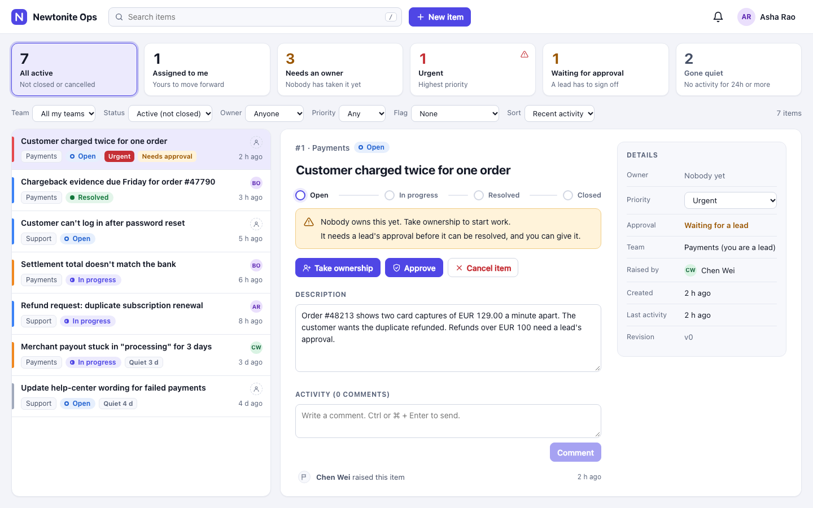
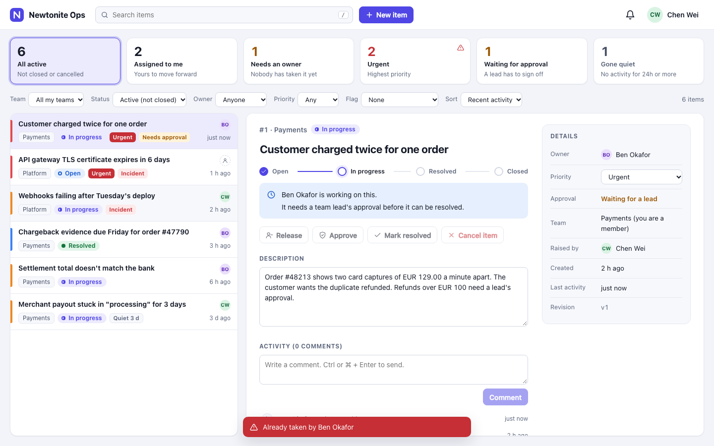
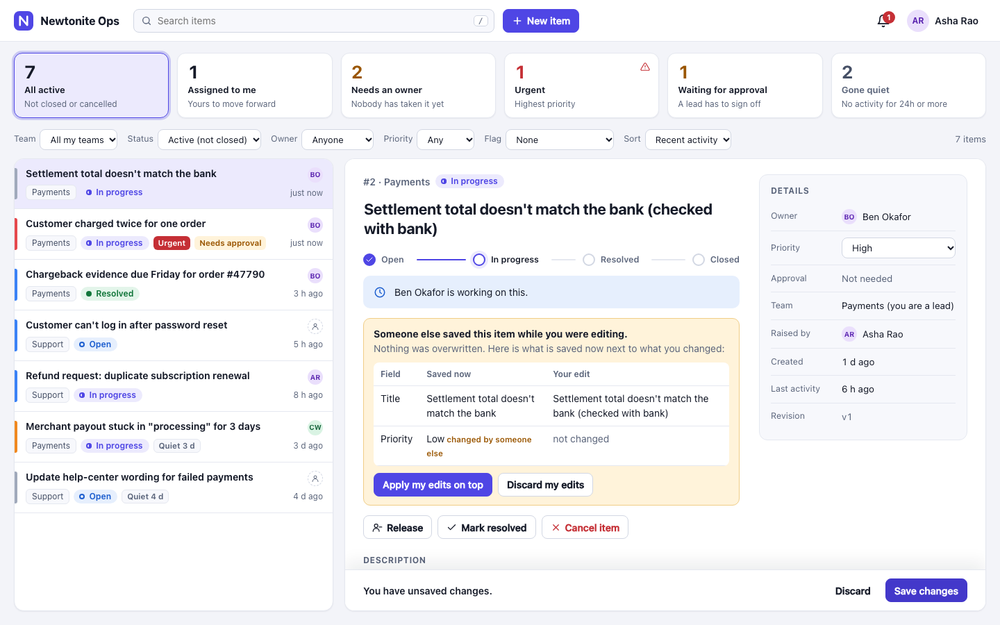
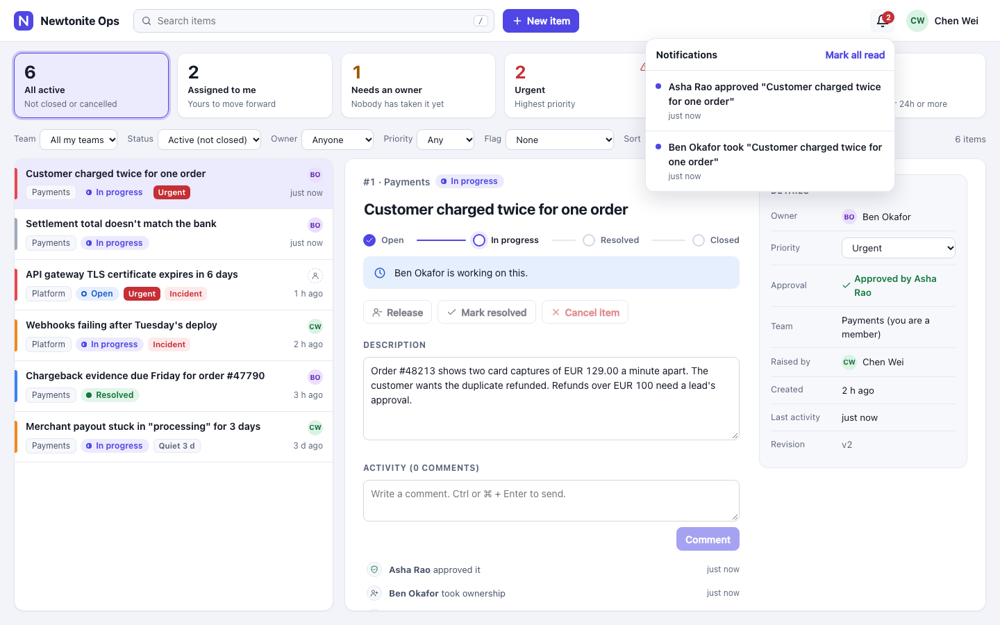
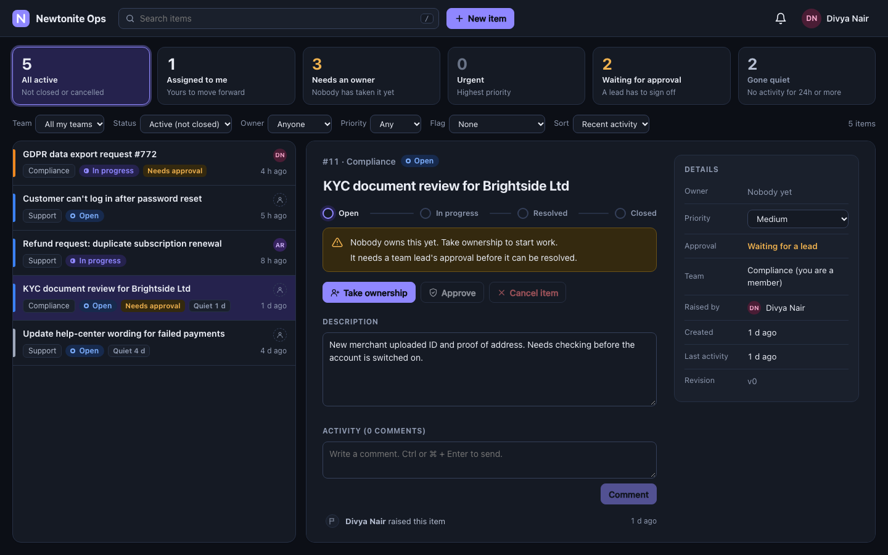
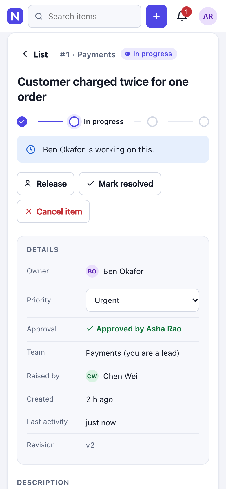
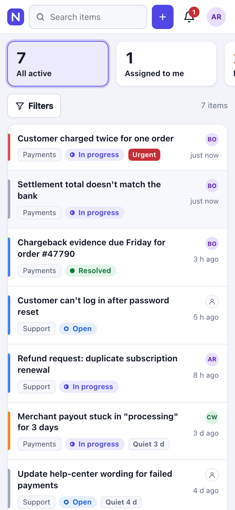
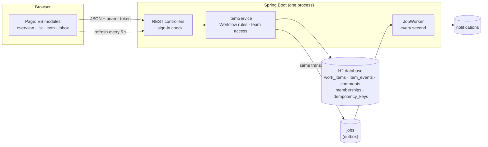

# Newtonite Ops

One shared queue for operational work. A request (a refund, an incident, a document check)
becomes a **work item** with an owner, a priority, an optional approval step and a complete
history. Teams see what needs attention, take ownership, discuss, approve and close, and
the system stays correct when several people touch the same item at the same time.



**Live demo:** https://newtonite-ops-quld.onrender.com (free hosting: the first visit after a quiet
period takes about a minute to wake up, and the data resets whenever it restarts).

Built with Java 21, Spring Boot 4.1, Spring Data JPA (Hibernate) and an H2 database stored
in a local file. The front end is plain HTML, CSS and JavaScript (ES modules, no build step).

**Read next:** [ENGINEERING_DECISIONS.md](ENGINEERING_DECISIONS.md) explains the important
decisions and trade-offs.

## Run it

You need **Java 21 or newer** (`java -version`). Nothing else: the Maven wrapper downloads
Maven and the dependencies the first time (internet needed once).

```bash
./mvnw spring-boot:run
```

Open http://localhost:8080 and pick a person to sign in as. The first start takes about 20
seconds. Stop with Ctrl+C.

```bash
./mvnw test                                  # the 58 automated tests (a minute or two)
rm -rf data && ./mvnw spring-boot:run        # start again with fresh demo data
PORT=9090 ./mvnw spring-boot:run             # another port, if 8080 is busy
./mvnw package && java -jar target/newtonite-ops-0.1.0.jar    # run as a single jar
```

Data lives in `./data` and survives restarts. If you ran an earlier version of this project,
delete `data/` once to get the current demo data.

To try it at the size the brief talks about, generate 50,000 extra items (takes ~4 seconds):

```bash
rm -rf data && ./mvnw spring-boot:run -Dspring-boot.run.arguments=--newtonite.seed-bulk-items=50000
```

In VS Code: install the **Extension Pack for Java**, open
`src/main/java/com/newtonite/ops/NewtoniteOpsApplication.java` and click **Run** above `main`.

## Deploy

The live demo above runs from this repository. `Dockerfile` builds and runs the app, and `render.yaml` describes it as a free web service on
[Render](https://render.com): choose **New → Blueprint**, pick this repository and apply. The
free plan sleeps after 15 minutes without visitors (the next visit takes a minute or so to wake
it), and its disk is temporary, so each restart begins again from the demo data.

## Demo data

6 people, 4 teams and 12 work items in different states (unowned, in progress, waiting for
approval, resolved, closed, and some nobody has touched for days). Roles are per team:

| Team       | Leads         | Members     |
|------------|---------------|-------------|
| Payments   | Asha, Farah   | Ben, Chen   |
| Support    | Divya         | Asha, Ben   |
| Platform   | Erik          | Chen        |
| Compliance | Farah         | Divya       |

## Five-minute tour

Each browser tab keeps its own sign-in, so **use two tabs to be two people**.

1. **What needs attention.** Sign in as Asha. The cards at the top are the answer: items that
   need an owner, urgent ones, ones waiting for approval, ones that have gone quiet. Click a
   card to get exactly that list. Each number is always the length of the list it opens.
2. **Two people claim the same item.** Tab 1: Ben. Tab 2: Chen. Both open "Customer charged
   twice for one order" and click **Take ownership**. The page shows you as owner at once
   (optimistic), one server answer says yes, the other says "Already taken by ..." and that
   page puts itself right.
   
3. **Two people edit the same item.** Tab 1: Asha. Tab 2: Farah. Both open "Settlement total
   doesn't match the bank". Asha starts changing the title. Farah changes the priority to Low
   and saves. Asha's page warns that the item changed, without touching what she typed. When
   she saves, nothing is overwritten: she sees both versions side by side, and
   **Apply my edits on top** keeps Farah's priority and adds Asha's title.
   
4. **Approval.** The refund from step 2 needs a lead's approval, so its owner can't resolve it
   yet (the button explains why). Asha (a Payments lead who neither raised nor owns it)
   approves. Now the owner can resolve and a lead can close. A lead can't approve their own work.
5. **Team access.** Sign in as Erik (Platform only). He can't see or search Payments items,
   and a link to one says "not found". The server enforces this; it is not just hidden.
6. **Notifications.** Sign in as Chen, who raised the refund. The bell shows what others did
   to it. They are sent by a background worker that retries on failure.
   
7. **Offline.** In the browser dev tools set the network to Offline, write a comment: it shows
   as "Not sent" with **Retry**. Go online and retry: it is stored exactly once.

Keyboard: `/` search, `n` new item, `j` / `k` next / previous item. Works on a phone, and in
dark mode (follows your system, or use the menu under your avatar).

<p>



</p>

## How the brief is covered

| The brief asks for | What is here |
|---|---|
| Understand an item: what, why, state, owner, history, what next | Item page: status steps, a plain-words "what happens next" line, owner and approval, full activity |
| Teams, roles, real authorization | Roles per team (lead / member). Every read and write checks team membership on the server. Outsiders get 404. A single table of workflow rules decides who may do what, and the page uses the same answer to grey out buttons |
| Collaboration and history | Comments; every change writes a history row in the same transaction |
| Concurrent use | Atomic claim, optimistic locking with a merge view, idempotency keys, stale-view warnings (see below) |
| Overview, find work, stay usable as it grows | Attention cards, filters, search, sorting, keyset paging, bounded item history |
| Asynchronous work that can fail or repeat | Transactional outbox, a retrying worker, duplicate-safe delivery |
| At least three situations beyond CRUD | Seven, listed next |
| ENGINEERING_DECISIONS.md, tests, known limitations | [ENGINEERING_DECISIONS.md](ENGINEERING_DECISIONS.md), [Tests](#tests), [Known limitations](#known-limitations) |

### The situations where correctness takes more than CRUD

1. **Two people claim the same item**: one conditional `UPDATE`; exactly one wins.
2. **Two people edit the same item**: version check; the loser gets both versions and a merge, never a silent overwrite.
3. **Two status changes at once** (resolve vs cancel, two approvals): exactly one takes effect and the history says so.
4. **A repeated request** (double click, retry after a timeout): `Idempotency-Key`; created once.
5. **Resource-level authorization**: team membership and role checked on every call, outsiders can't even learn an id exists.
6. **Reliable background work**: notifications are queued with the change, retried with backoff, never sent twice.
7. **Optimistic UI vs the server's decision**: claim and comment show instantly and are corrected or retried when the server disagrees or the network drops.

## Tests

`./mvnw test` starts the real app on a random port with an in-memory database and calls the
API over HTTP, like the browser does. The concurrency tests send requests from several threads
at the same moment, so they exercise the database, not a mock. They cover what would hurt most
if wrong:

| Risk | Tests |
|---|---|
| Double claim | `ClaimTest` (six claims at once, exactly one wins) |
| Lost update | `ItemEditingTest` (stale save refused with the current item; two saves at once, one wins) |
| Conflicting status changes | `WorkflowRaceTest` (resolve vs cancel, two approvals, repeated clicks, edit after someone claimed) |
| Duplicates from retries | `IdempotencyTest` (including two identical requests at once) |
| Leaking another team's data | `AccessTest`, `PagingTest`, `OverviewTest`, `HistoryPagingTest` |
| Approval and workflow rules | `ApprovalTest` |
| Notifications lost or doubled | `NotificationJobTest` (delivery fails on purpose; retried; dead after 5; never twice) |
| Paging skips or repeats rows | `PagingTest` (all sort orders, identical timestamps, bad cursors) |
| Cards that disagree with their lists | `OverviewTest` |
| Long histories | `HistoryPagingTest` |

Two optional checks live in [`e2e/`](e2e) because they need more than Java:

- `e2e/soak_test.py` (Python 3 only): 10 threads hit 12 items with random actions for a while,
  then verify the rules (version equals the number of changes, no in-progress item without an
  owner, no approval needed but skipped, no 5xx). In a 45-second run it made about 17,000 requests
  with zero server errors and zero broken rules.
- `e2e/ui_checks.py` (Python + Playwright, uses your Chrome): 55 checks in a real browser with
  several people signed in at once: the claim race, the conflict view, comment retry after
  going offline, session expiry, the offline banner, paging, a phone layout and more.

## Performance at the size in the brief

Measured on a laptop with 50,000 items, one user, warm (`PagingTest` and the keyset design are
why the deep pages cost the same as the first):

| Request | Median |
|---|---|
| First page of the list (30 rows, with total) | 17-26 ms |
| Filtered page (mine / team + priority) | 13-16 ms |
| Page 249 of 100-row pages (a keyset cursor, not an offset) | 45-57 ms |
| Overview numbers (one aggregate query) | 75 ms |
| Text search, 1,200 matches | 160-200 ms |
| Text search, no match (scans every row) | 250-280 ms |

Text search is the first thing that would need a real index at 10x this size.

## API

All endpoints except the first two need `Authorization: Bearer <token>` from `/api/login`.
Errors look like `{"error": "already_claimed", "message": "Already taken by Ben Okafor"}`.

| Method and path | What it does |
|---|---|
| `GET /api/users` | People to pick from on the sign-in screen (demo only) |
| `POST /api/login` `{userId}` | Signs in, returns a token (valid 12 hours) |
| `POST /api/logout` | Signs out |
| `GET /api/me` | Who I am and my teams |
| `GET /api/items` | One page of my teams' items: `{items, total, nextCursor}`. Filters: `q`, `teamId`, `status` (`active` = not closed or cancelled, or one status), `assigned` (`me`, `unassigned`), `priority`, `attention` (`approval`, `stale`), `sort` (`updated`, `priority`, `created`). Paging: `limit` (default 30, max 100) and `cursor` (the `nextCursor` of the previous page) |
| `GET /api/items/overview` | The attention numbers: `active`, `mine`, `unassigned`, `urgent`, `needsApproval`, `stale`. Optional `teamId`. Each equals the `total` of the matching list filter |
| `POST /api/items` | New item. Send an `Idempotency-Key` header |
| `GET /api/items/{id}` | The item, the actions I can take (and why not), and the newest 50 history entries with their comments |
| `GET /api/items/{id}/history?before={eventId}` | Older history entries, 50 at a time |
| `PATCH /api/items/{id}` `{version, ...}` | Edit title, description or priority. 409 `conflict` with the current item if `version` is out of date |
| `POST /api/items/{id}/claim` | Take ownership. 409 `already_claimed` if someone else has it |
| `POST /api/items/{id}/actions/{action}` | `release`, `approve`, `resolve`, `close`, `reopen`, `cancel` |
| `POST /api/items/{id}/comments` | Add a comment. Send an `Idempotency-Key` header |
| `GET /api/notifications` | My latest notifications and unread count |
| `POST /api/notifications/read` | Mark all as read |

## How it is put together



```
src/main/java/com/newtonite/ops/
  auth/    people, teams, roles, demo sign-in, the check that runs on every request
  items/   work items, the workflow rules (Workflow.java), search and paging, history, the API
  jobs/    outbox jobs, the worker, notifications
  web/     error responses and Idempotency-Key handling
  DemoData.java, BulkSeed.java   the starting data, and the optional 50,000-item generator
src/main/resources/static/
  index.html, styles.css
  js/      main (wiring) · list · overview · detail · inbox · newitem · signin · api · state · dom
src/test/java/    the tests
e2e/              the soak test and the browser checks (optional)
docs/screenshots/ the pictures above
```

## Known limitations

- **Sign-in is a demo picker** with no passwords, and `/api/users` is public. Real login (SSO)
  would replace `AuthController` and `AuthInterceptor`; nothing else depends on how people sign in.
- **The page refreshes by polling** every 5 seconds (4 small requests). Fine for a team, but at
  thousands of simultaneous users it should become server-sent events with cached counts.
- **Text search is a substring scan** (fine to tens of thousands of items; see the numbers).
  Postgres full-text or trigram indexes are the next step.
- **One database file, one process.** H2 is there so nothing needs installing. The queries are
  plain JPQL, so moving to Postgres is a driver and URL change plus Flyway migrations (Hibernate
  creates the tables on start today, `ddl-auto=update`).
- **Notifications are in-app only.** Jobs that fail 5 times are kept as `DEAD` with their last
  error, but there is no screen to inspect or retry them.
- **Not built:** attachments, due dates and SLAs, moving an item to another team, mentions, an
  admin screen, audit export.
- **Paging while data changes:** an item that changes while you are paging may move to the top
  of the list; the page tells you ("New activity. Refresh the list") instead of reshuffling under you.

## What I would do next

1. Real sign-in through the company's identity provider, with the role model unchanged.
2. Postgres + Flyway, then full-text search on title and description.
3. Server-sent events instead of polling, and cached team-level counts for the cards.
4. Due dates and alerts for urgent items that sit unowned; an inbox that links to the exact change.
5. A small admin page to inspect and retry dead jobs.
